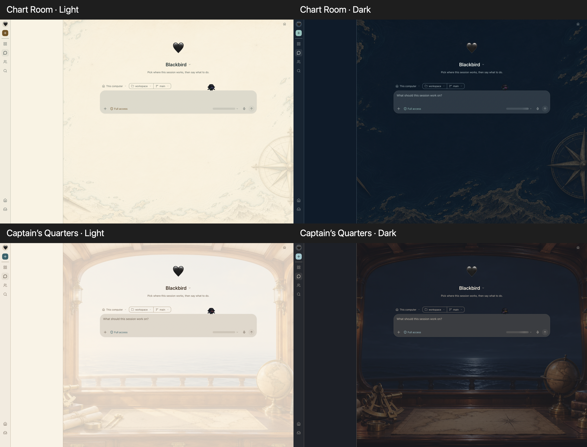

# Nautical Themes

Three OpenClaw Control UI themes, each with complete light and dark palettes and matching original AI-generated background artwork:

- **Chart Room**: warm ivory parchment, teal coastlines and brass navigation; midnight navy and gold after dark.
- **Captain’s Quarters**: sunlit oak cabin and pale sea; lantern-lit walnut and moonlit ocean after dark.

## Use

Requires OpenClaw 2026.11.1 or newer. After installation and enablement through the managed plugin flow, select `nautical-themes/chart-room` or `nautical-themes/captains-quarters` in Settings → Appearance. Select theme artwork under Appearance → Background. Visibility, placement and accessibility controls remain yours.

## Scope and validation

Static themes only. The no-op runtime entry registers no tools, network access or services. No runtime dependencies or install lifecycle scripts. The shipped WebP backgrounds stay below the 512 KiB per-image limit. `npm test` checks complete palettes, definition sizes, metadata, 60 text contrast pairs (4.5:1 minimum), focus-ring contrast and background signatures/sizes. Token contrast checks do not guarantee composited text contrast.

AI-generated PNG masters are retained locally in `artwork/`; distribution includes only compressed WebP assets. The fictional maps are decorative, not navigational charts. UI text uses system fonts for reliable readability.

## Real Control UI previews · 2026-11-11

Validated in an authenticated Chrome tab on the actual Control UI New Session screen at 1440×1000 and 1100×900, for both themes in both modes. The host palette normalizer and background CSS were used for temporary browser-only previews, with maximum supported artwork visibility (32% dark / 20.8% light). Private sidebar contents and recent sessions were hidden before capture. Navigation cleared the preview overrides afterward; saved preferences were not changed.

[Individual desktop screenshots](previews/) · [Narrow desktop screenshots](previews/narrow/)

Checks passed: 40 token text-contrast pairs, focus-ring contrast, four WebP signatures/file limits, both definitions through OpenClaw's normalizer, and npm package dry run. Visual inspection found readable central controls and no overlapping artwork at the tested sizes. Narrow views crop the compass rose, globe and peripheral instruments; this is expected cover behavior. Portrait/mobile, conversation screens, installed-plugin admission and end-to-end plugin discovery remain unverified. These are real UI previews, not proof of installation. Nothing has been published to ClawHub.

## Signal Flags · 0.2.0

Adds **Signal Flags**, with sailcloth-white/navy/red light colors and admiralty-blue/brass dark colors. International Code of Signals letter flags spell **OPENCLAW** across a halyard above a quiet reading area. The flags are decorative lettering, not an operational signal or navigational aid. Editable SVG originals are included in the repository; compressed WebP backgrounds ship with the plugin. No changes to the two existing themes.

Validation: 60 palette text-contrast checks and all six background signature/size checks; host theme-definition normalization. The new theme has not yet been checked in an installed Control UI. Existing screenshots show the original two themes only.
