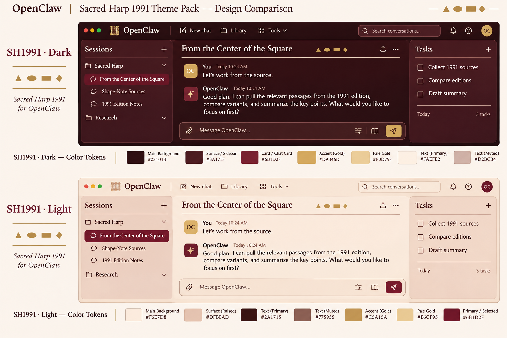

# Sacred Harp Themes

*A love letter to a tradition I hold dear*

Two edition-inspired themes, each with complete light and dark palettes:

- **SH1991 · Oxblood**: wine-dark surfaces, warm paper, gold highlights.
- **SH2025 · Pine**: forest-green surfaces, pale sage paper, gold highlights.

Static OpenClaw Control UI theme plugin; no tools, services, dependencies, external font requests or lifecycle scripts. Existing UI structure and product name are preserved. The original four-shape mark uses triangle (fa), oval (sol), rectangle (la), diamond (mi). Both themes default to a serif stack: Libre Baskerville, Iowan Old Style, Baskerville, Georgia, Times New Roman, serif. Available local fonts are used; no remote fonts are downloaded or bundled. Code and technical output retain monospace. No separate heading-font mechanism is assumed.

## Use

Declared baseline: OpenClaw 2026.11.1. After managed installation and enablement, choose `sacred-harp-themes/sh1991` or `sacred-harp-themes/sh2025` in Settings → Appearance. This source change does not install the plugin or change saved appearance.

## Sources and adaptation

`palette-sources.json` records the edition-specific entries from Shape-Note Atlas’s `public/corpus.json` (jjjhenriksen/shapenote-atlas), read 2026-11-11. Unlike the earlier concepts, these use actual per-edition overrides, not the generic base CSS. Background, foreground, raised surfaces and gold retain those tokens. SH1991 light muted text is darkened to `#63433f` to meet 4.5:1 on its raised surface. Translucent card colors are composited onto edition backgrounds into portable opaque hex. Light primary actions use dark edition colors instead of low-contrast gold text. Border, input and destructive tokens are accessibility adaptations.

The original SVG mark was authored for this pack. No book-cover images, score scans or remote assets are bundled.

## Validation

Run `npm test` for 40 text-contrast checks (at least 4.5:1), focus-ring contrast, required colors, manifest consistency, definition byte limits and self-contained icon checks. Run `npm pack --dry-run` to inspect distribution. Both definitions also passed the local OpenClaw theme normalizer. Token checks do not prove installed discovery, actual browser rendering, mobile layout or composited contrast; those remain unverified.

## Concept preview

Generated with the built-in image tool on 2026-11-11. Prompt: paired OpenClaw desktop AI-chat mockups in SH1991 light/dark, exact Atlas oxblood/parchment/gold tokens, restrained four-shape decoration, serif headings and readable chat text. This is design reference only: the image contains invented UI and decorative details, and is not proof of supported layout or shipped behavior. It is excluded from the plugin package.
